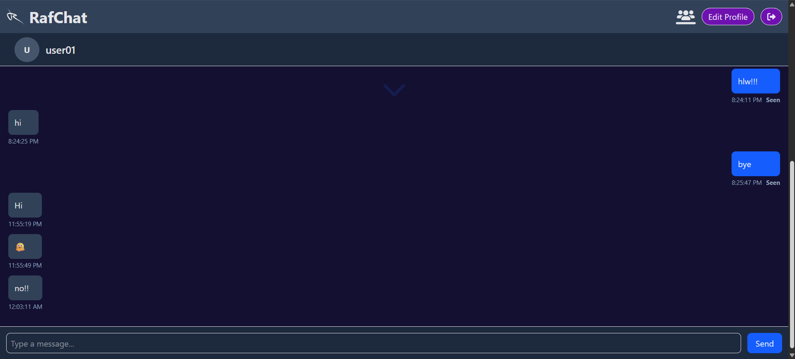
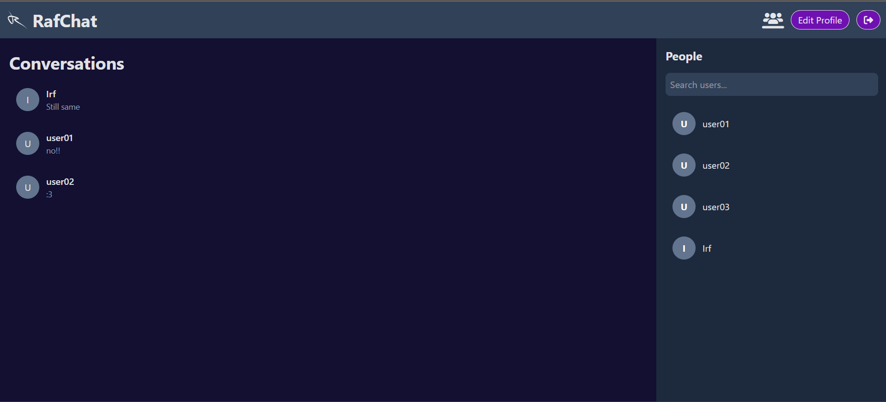
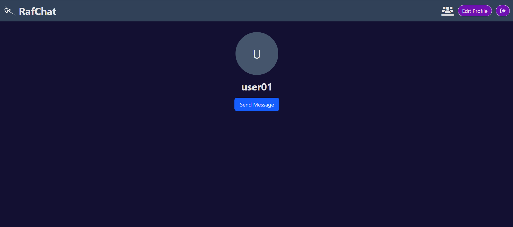
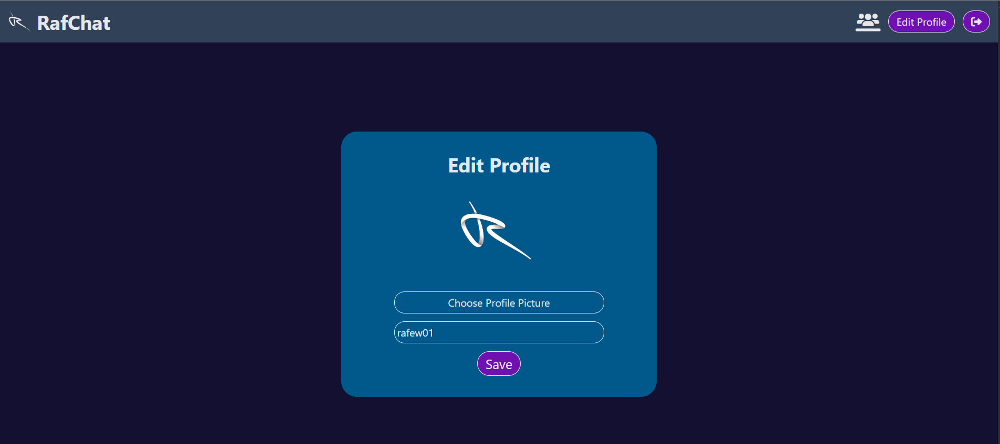

# RafChat

[](https://react.dev/)
[](https://tailwindcss.com/)
[](https://supabase.com/)
[](https://vercel.com/)

Real-time messaging application built with React, Tailwind CSS, and Supabase.

🚀 Realtime Messaging • 👤 Profiles • ✅ Seen Status • 📸 Avatar Upload

🔗 Live Demo: https://rafchat.vercel.app/

## Features

- Authentication (Register, Login, Logout)
- Custom user profiles
- Avatar upload
- User discovery and search
- Recent conversations
- Real-time messaging
- Seen status 
- Profile pages
- Responsive design
- Persistent message history

## Tech Stack

### Frontend
- React
- React Router
- Tailwind CSS

### Backend
- Supabase Authentication
- Supabase Database (PostgreSQL)
- Supabase Realtime
- Supabase Storage

### Deployment
- Vercel

## Screenshots

### Chat Page


### Conversation Page


### Profile Page


### Edit Profile Page


## Local Development

Clone the repository:

```bash
git clone https://github.com/yourusername/rafchat.git
cd rafchat
```

Install dependencies:

```bash
npm install
```

Create a `.env` file:

```env
VITE_SUPABASE_URL=your_supabase_url
VITE_SUPABASE_ANON_KEY=your_supabase_anon_key
```

Run:

```bash
npm run dev
```

## Project Status

✅ RafChat v1.0.0 Complete

### Completed
- Authentication
- Profiles
- Avatar Upload
- Real-Time Messaging
- Recent Chats
- Seen Status

### Future Improvements
- Image Messaging
- Unread Message Counts
- Online Status
- Typing Indicator

## Author

Md. Aryan Nur Rafew